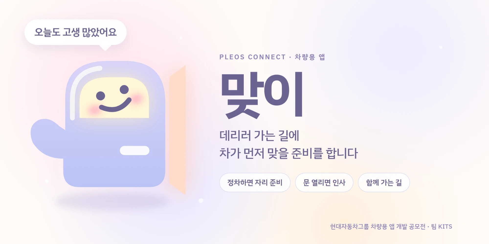
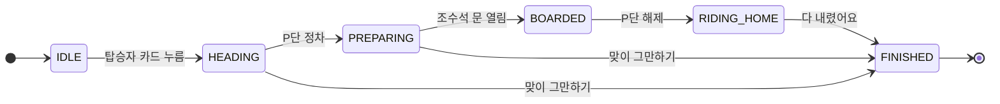

<div align="center">



# 맞이

**데리러 가는 길에 차가 먼저 맞을 준비를 합니다**

기다리는 동안 소중한 가족의 자리를 미리 맞춰 두고<br>
문이 열리는 순간 먼저 인사를 건네는 마중 차량용 앱입니다.


현대자동차그룹 차량용 앱 개발 공모전 · Pleos Connect 출품작 · 팀 KITS

</div>

<br>

## 🚩 프로젝트 소개

데리러 가서 기다리는 동안 운전자가 조수석 온도·열선·시트를 하나씩 챙기기는 어렵습니다.
탑승자는 앉은 뒤에야 춥거나 덥다는 것을 알게 되고 가족마다 체형과 선호가 달라 탈 때마다 다시 조절합니다.
휴대폰은 조수석 열선을 켜거나 시트를 움직이거나 문이 열리는 순간을 알 수 없습니다.
맞이는 정차 · 문 열림 · 출발 같은 차 상태에 맞춰 그 사람의 자리를 대신 준비하고, 탑승자가 "나를 기다리고 있었구나"를 느끼게 합니다.

> 실차 차량 제어는 아직 공개 전입니다. 차량을 움직이는 기능은 모두 **Pleos Connect 에뮬레이터에서 검증**했습니다.

<br>

## 🎞️ 시연 영상

[](https://youtu.be/0cKsSiLcIhI)

👉 이미지를 누르면 YouTube에서 영상이 열려요.

<br>

## 🔥 주요 기능

✅ 구현 · 🧪 에뮬레이터 검증 · 🔜 예정

| 기능 | 설명 | 상태 |
| --- | --- | :---: |
| 👤 탑승자 프로필 | 이름 · 인사 · 시트 위치 · 창문 닫기를 저장합니다. 열선·온도는 겨울(11–3월)과 여름(4–10월) 값을 따로 기억합니다. | ✅ |
| 🅿️ 정차하면 자리 준비 | 맞이 중 P단에 서면 바꾸기 전 상태를 기억하고 조수석 시트 · 열선·통풍 · 온도를 맞춥니다. "자리 맞춰 둘게요" → "자리 준비 다 됐어요"로 알립니다. | 🧪 |
| 🆕 처음 맞이하는 사람 | 이번 계절 값이 없으면 "처음 맞이하네요" 화면에서 바로 맞추고 저장합니다. "다음에"를 누르면 안내음 없이 넘어갑니다. | 🧪 |
| 🚪 탑승 인사 | 조수석 문이 열리면 시트를 멈추고 그 사람을 위한 인사 음성을 들려줍니다. 오늘만의 인사는 한 번 쓰면 평소 인사로 돌아옵니다. | 🧪 |
| 🌙 함께 가는 길 | 출발하면 열려 있던 창문을 닫습니다. 타는 동안 앱에서 열선·통풍 · 온도를 바꿀 수 있고, 시트는 정차 중에만 움직입니다. | 🧪 |
| 📈 선호 학습 | 탑승자가 타는 동안 바꾼 온도 · 열선·통풍 값을 기억해 다음 맞이에 그 값으로 준비합니다. | 🧪 |
| ↩️ 원래대로 돌리기 | "다 내렸어요"를 누르면 시트 · 열선 · 온도 · 창문을 맞이 전 상태로 돌립니다. | 🧪 |
| 🛡️ 안전과 예외 | 주행 중에는 설정을 잠급니다. 제어가 안 되는 차에서는 화면 안내로 바꾸고 앱이 다시 켜지면 진행 중이던 단계를 이어받습니다. | 🧪 |

<details>
<summary>🔜 예정 기능</summary>

- 맞이 장소를 내비 목적지로 설정 (연결 구조만 있음)
- 음성으로 맞이 시작
- 백그라운드 서비스 (지금은 앱이 화면에 있을 때 동작)
- 기능별 지원 여부에 따라 되는 기능만 실행 (지금은 확인만 함)
- 등받이 각도 조절

</details>

<br>

## 🔄 맞이 흐름



| 단계 | 차가 하는 일 |
| --- | --- |
| `PREPARING` | 원래 상태 저장 → 시트 · 열선 · 온도 맞춤 → 준비 안내음 |
| `BOARDED` | 시트 정지 → 인사 |
| `RIDING_HOME` | 창문 닫기 → 탑승자가 바꾼 값 기록 |
| `FINISHED` | 원래 상태로 복구 → 마지막 값 기억 (맞이 그만하기는 기억하지 않음) |

<br>

## 🪄 기술 스택

| 분류 | 기술 |
| --- | --- |
| 언어 · 빌드 | Kotlin 2.0.21 · JDK 17 · Gradle 8.9 · AGP 8.7.3 · KSP |
| 플랫폼 | Android Automotive OS (minSdk 28 · targetSdk 34) |
| 차량 SDK | Pleos Vehicle SDK 2.3.2 (Gear · Door · Seat · HVAC · Window) |
| 음성 | MediaPlayer · AudioFocus |
| UI | Jetpack Compose (BOM 2024.09.03) · Material3 · Haze 1.1.1 |
| 저장 | Room 2.6.1 (탑승자 프로필 · 진행 중인 맞이 상태) |
| 테스트 | JUnit 4 단위 테스트 156개 · Pleos Connect 에뮬레이터 연동 테스트 |

<br>

## 🧪 테스트 환경

| 항목 | 값 |
| --- | --- |
| 에뮬레이터 | Pleos Connect Emulator 2.1 (AVD 기기 `Pleos Connect v2.1.0`) |
| 시스템 이미지 | Android API 34 · Automotive · arm64-v8a |
| 화면 규격 | 2560 × 1440 · 160dpi · 가로 (앱은 오른쪽 영역에 표시) |
| RAM | 4GB |
| 부팅 | **Cold boot 필수** (Quick boot면 차량 신호가 동작하지 않음) |
| 개발 PC | macOS (Apple Silicon) · Android Studio |

**필요한 설정**

- 시스템 이미지는 [Pleos Connect SDK·에뮬레이터 설정 문서](https://document.pleos.ai/docs/connect/guide/getting-started/application-development/setup-connect-sdk-emulator)대로 SDK Manager에 업데이트 사이트를 추가해 설치합니다.
- Apple Silicon Mac에서는 Vulkan을 끄고 실행해야 멈추지 않습니다.
- 차량 신호는 Virtual Console(`http://127.0.0.1:8088/`)에서 바꿉니다. 조수석은 FR · PASSENGER입니다.
- Pleos SDK는 `nexus-playground.pleos.ai` 저장소에서 받습니다. 별도 인증 정보는 필요 없습니다.

<details>
<summary>사용 권한</summary>

| 권한 | 용도 |
| --- | --- |
| `pleos.car.permission.CAR_SEATS` · `CONTROL_CAR_SEATS` | 조수석 시트 이동 · 열선·통풍 |
| `pleos.car.permission.CAR_CLIMATE` · `CONTROL_CAR_CLIMATE` | 조수석 온도 |
| `pleos.car.permission.CAR_WINDOWS` · `CONTROL_CAR_WINDOWS` | 조수석 창문 |
| `pleos.car.permission.CAR_DOORS` | 조수석 문 열림 |
| `pleos.car.permission.CAR_DRIVE` · `CAR_POWERTRAIN` | 기어(P단) · 주행 상태 |
| `pleos.car.permission.NAVI_ROUTE` | 내비 목적지 (🔜 예정) |

</details>

<br>

## ⚙️ 실행 방법

빌드 없이 **APK를 받아 에뮬레이터에 설치**하면 바로 실행할 수 있습니다. 소스에서 빌드하려면 [소스에서 빌드하기](#소스에서-빌드하기)를 보세요.

### 📦 APK

| 항목 | 내용 |
| --- | --- |
| 파일 | [`apk/KITS_맞이_release.apk`](apk/KITS_맞이_release.apk) |
| 버전 | 0.1.0 · release 서명 |
| 크기 | 약 41MB |
| 실행 환경 | Pleos Connect Emulator 2.1 (Android API 34 · Automotive) — [테스트 환경](#-테스트-환경) 참고 |

### APK로 실행하기

**1. APK 받기**

위 표의 파일 링크를 열고 오른쪽 위 **Download raw file**(⬇️)을 누릅니다. 저장소를 통째로 받았다면 `apk/` 폴더에 있습니다.

**2. Pleos Connect 에뮬레이터 준비하기 (처음 한 번)**

Android Studio가 필요합니다. 자세한 내용은 [Pleos Connect SDK·에뮬레이터 설정 문서](https://document.pleos.ai/docs/connect/guide/getting-started/application-development/setup-connect-sdk-emulator)를 따릅니다.

1. **Tools → SDK Manager → SDK Update Sites** 탭에서 **+**를 누르고 Pleos 시스템 이미지 주소를 추가합니다.
   - Apple Silicon Mac: `https://nexus-playground.pleos.ai/repository/raw-releases/connect-avd/2.x/crp-arm64-sys-img.xml`
   - 그 밖의 PC는 위 문서에 있는 주소를 씁니다.
2. **SDK Platforms** 탭에서 **Show Package Details**를 켜고 Android API 34 아래 **Pleos Connect System Image**를 설치합니다.
3. **Tools → Device Manager → Create device**에서 **Automotive → `Pleos Connect v2.1.0`**을 고르고 API 34 이미지로 만듭니다.
4. **Advanced Settings**에서 **Default boot = Cold**, **RAM = 4GB**로 바꿉니다. Quick boot면 차량 신호가 동작하지 않습니다.

**3. 에뮬레이터 켜기**

Device Manager에서 ▶를 누르거나 터미널에서 실행합니다.

```bash
# Cold boot + Vulkan 끄기 (Apple Silicon은 Vulkan을 꺼야 멈추지 않습니다)
$ANDROID_HOME/emulator/emulator -avd <Pleos AVD 이름> -no-snapshot -feature -Vulkan &
adb wait-for-device
```

**4. APK 설치하기**

받은 APK 파일을 에뮬레이터 화면에 **끌어다 놓거나** 터미널에서 설치합니다.

```bash
adb install KITS_맞이_release.apk
```

> 같은 기기에 디버그 버전이 이미 설치돼 있으면 서명이 달라 설치가 실패합니다. `adb uninstall com.maji`로 지운 뒤 다시 설치하세요.

**5. 앱 열기**

에뮬레이터 앱 목록에서 **맞이**를 누르거나 터미널에서 엽니다.

```bash
adb shell am start -n com.maji/.MainActivity
```

**6. Virtual Console 열기**

차량 신호(기어 · 문 등)는 브라우저의 Virtual Console에서 바꿉니다.

```bash
adb forward tcp:8088 tcp:8088
open http://127.0.0.1:8088/   # Windows는 브라우저에서 주소를 직접 엽니다
```

**7. 맞이 한 바퀴 돌려 보기**

1. 기어를 **P**로 두고 "맞이할 사람 추가"로 탑승자를 만듭니다. 이름은 에뮬레이터 **화면 키보드**로 입력합니다 (PC 키보드로는 한글이 입력되지 않을 수 있습니다).
2. 탑승자 카드의 **맞이하러 가기**를 누릅니다. 처음 맞이하는 사람이면 자리 설정 화면이 바로 뜹니다.
3. 기어를 **D → P**로 바꾸면 자리 준비가 시작됩니다.
4. **BODY → DOORS → FR** 문을 열면 인사가 나옵니다.
5. 기어를 **D**로 바꾸면 창문이 닫힙니다.
6. 다시 **P**로 두고 **다 내렸어요**를 누르면 원래 상태로 돌아갑니다.

신호별로 바꾸는 곳과 로그 확인 방법은 [Virtual Console 신호 테스트 방법](docs/signal-test-guide.md)에 있습니다.

### 소스에서 빌드하기

에뮬레이터를 켠 뒤 빌드하고 설치합니다. 앱 열기부터는 위 5~7번과 같습니다.

```bash
git clone https://github.com/pleos-connect-maji/pleos-connect-maji.git
cd pleos-connect-maji
./gradlew installDebug
```

<details>
<summary>단위 테스트 실행</summary>

```bash
./gradlew testDebugUnitTest
```

</details>

<br>

## 📁 프로젝트 구조

```
app/src/main/java/com/maji/
├── contract/   # 팀 함수 약속과 공통 데이터 (Profile · Climate · MajiStep)
├── signal/     # 차량 신호: 기어 · 조수석 문 · 열선·온도 변화 · 지원 기능 확인
├── control/    # 차량 제어: 시트 · 열선·통풍 · 온도 · 창문 · 원래 상태 복구
├── flow/       # 맞이 단계 흐름 · 학습 규칙 · 진행 상태 저장과 복원
├── profile/    # 탑승자 프로필 저장 (Room) · 계절 프리셋 · 값 범위 검사
├── voice/      # 인사 · 안내 음성 · 오디오 포커스
├── ui/         # 화면 (홈 · 진행 · 자리 설정 · 탑승자 관리) · 디자인 테마
└── MainActivity.kt
app/src/debug/  # 개발용 확인 화면 (debug 빌드에만 포함)
app/src/test/   # 단위 테스트
docs/           # 설계 · 테스트 문서
```

흐름(`flow`)이 신호(`signal`)를 받아 제어 · 프로필 · 음성을 부릅니다. 함수 약속은 [`contract/Contract.kt`](app/src/main/java/com/maji/contract/Contract.kt)에 있습니다.

<br>

## 💁 팀 구성

| 역할 | 담당 |
| --- | --- |
| 차량 신호 | P단 · 조수석 문 · 열선·온도 변화 감지, 지원 기능 확인, 주행 중 화면 잠금 |
| 차량 제어 · 디자인 | 시트 · 열선·통풍 · 온도 · 창문 제어, 원래 상태 저장·복구, 대체 모드, 화면 디자인, 타는 동안 자리 조절 |
| 맞이 흐름 | 단계 관리, 시작·진행 화면, 최종 하차 버튼, 학습 연결, 앱 재시작 후 이어받기 |
| 프로필 | 프로필 저장, 탑승자 관리·자리 설정 화면, 계절 프리셋, 학습 규칙 |
| 음성 · 통합 | 인사 · 안내 음성, 오디오 포커스, 프로젝트 골격, GitHub 관리, README |

<br>

## 🌟 향후 발전 방안

| 단계 | 시기 | 내용 |
| --- | --- | --- |
| 1단계 | 출시 ~ 6개월 | 조수석 맞이 완성, 명절 귀성 · 손님 모시기 같은 한 번뿐인 마중까지 확대 |
| 2단계 | 6 ~ 18개월 | 뒷자리까지 넓히고, 반복 일정을 배워 "오늘도 맞이하실까요?" 먼저 제안 |
| 3단계 | 18개월 ~ | 프로필을 계정에 연결해 렌터카 · 카셰어링 · 법인차 · 해외로 확장 |
